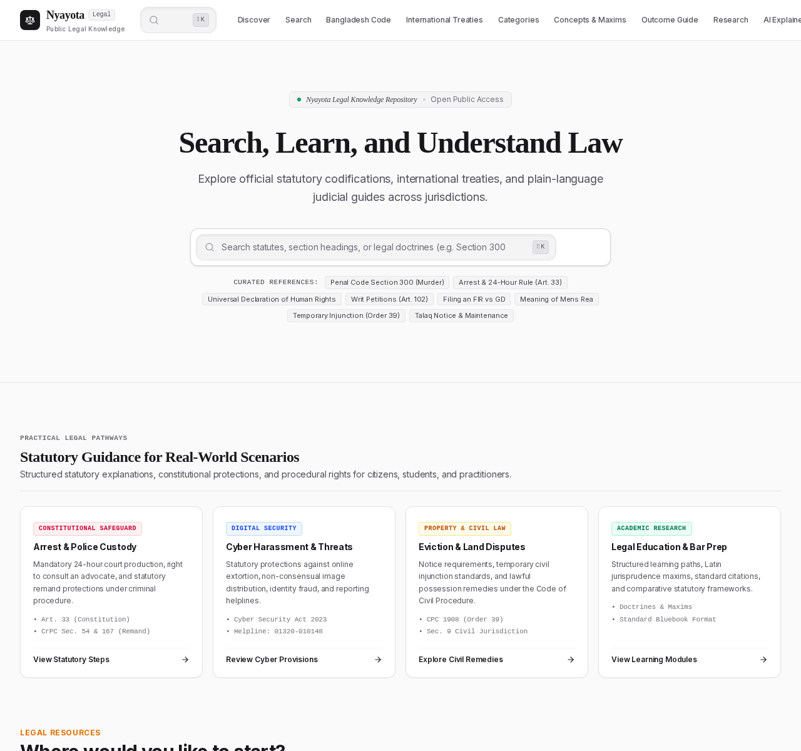

Nyayota is a legal information platform for people who need to *find* a provision and then
understand it. It covers major Bangladeshi statutes across the pre-independence, Pakistani and
Bangladeshi eras, plus a set of international instruments such as the UDHR and ICCPR.

*The Nyayota homepage — search-first, with featured statutes and guided pathways for common legal situations.*

## What is inside

The catalogue is organised by act, then chapter, then section. Each section carries its own
heading, marginal notes, cross-references and a short plain-language explanation, so the same
record can serve a law student checking a citation and a reader trying to understand what a
provision actually does.

Around that core sit a few tools that only make sense once the data is structured:

- **Search** runs client-side over the whole corpus and keeps recent queries locally.
- **Compare** puts two provisions side by side, aligned by section.
- **Cite** formats a reference in the style a reader's institution expects.
- **Verify** shows where the text came from and when it was last checked.

## Scope and honesty

Nyayota is deliberately an educational and informational platform. It does not give legal advice,
does not represent anyone, and does not claim to replace a lawyer or an official gazette. Where a
feature is incomplete — the conversational assistant, for instance — the interface says so rather
than pretending otherwise.

That discipline is also visible in the content: each provision is tied to a named source, and the
project publishes its roadmap publicly so readers can see what is finished and what is still
planned.
